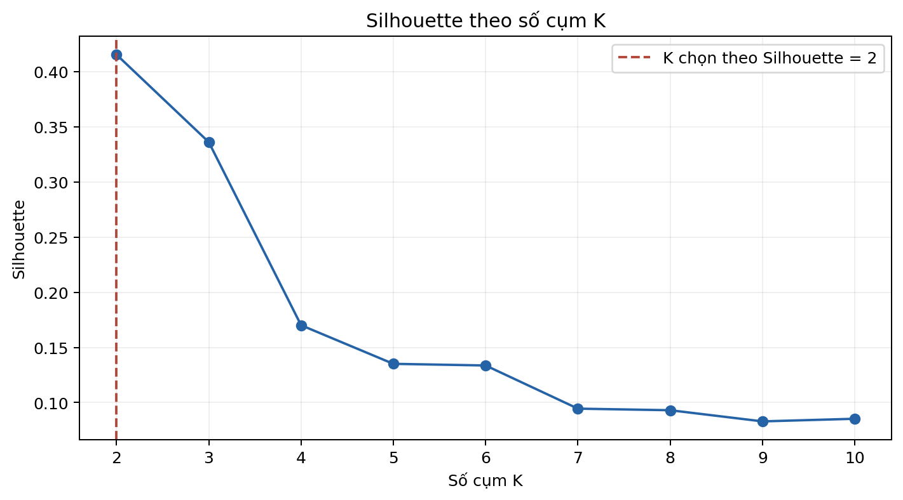
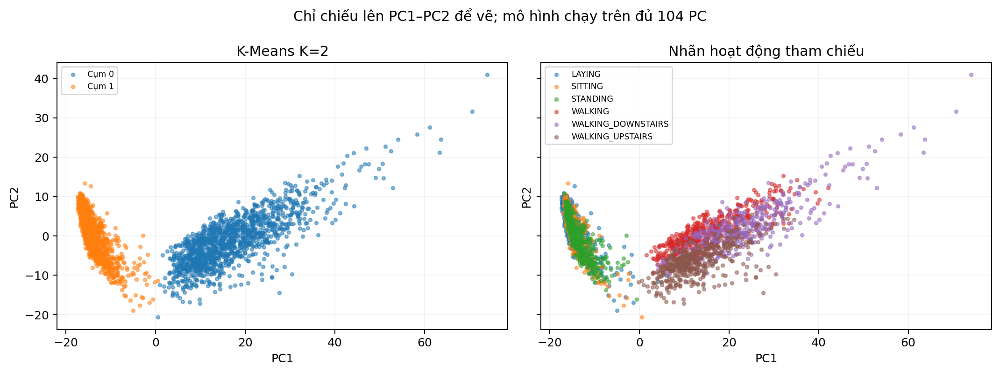

# Human Activity Clustering

Phân nhóm hoạt động con người từ dữ liệu UCI HAR bằng K-Means và Hierarchical Clustering.

## Quy trình

1. `notebooks/01_EDA.ipynb`: khám phá dữ liệu (Thảo).
2. `notebooks/02_Preprocessing_and_PCA.ipynb`: chuẩn hóa, PCA và lấy mẫu (Ly).
3. `notebooks/03_KMeans.ipynb`: khảo sát K=2…10, đánh giá và bàn giao (Thành).
4. Phần Hierarchical do Huy bổ sung, dùng đúng tập mẫu và thứ tự dòng đã cố định.

## Cài đặt và chạy phần K-Means

Yêu cầu Python 3.10 trở lên. Từ thư mục gốc repo:

```bash
python -m pip install -r requirements.txt
python src/run_kmeans.py
```

Hoặc mở Jupyter và chạy lần lượt tất cả các cell trong `notebooks/03_KMeans.ipynb`:

```bash
python -m jupyter notebook
```

Dữ liệu và cấu hình bàn giao đã có trong repo nên không cần chạy lại tiền xử lý để thực hiện phần K-Means. Notebook đã lưu đầu ra từ lần chạy thực tế. Phiên bản thư viện và SHA-256 của đầu vào được ghi trong `results/kmeans/experiment_config.json`. Cùng cấu hình và phiên bản giúp tái lập kết quả; thời gian và một số sai số số học có thể khác theo môi trường.

## Đầu vào cố định

- `data/processed/sampled_data_scaled_pca.csv`: 3.000 dòng, 104 cột PC và bốn cột tham chiếu.
- `data/processed/sample_indices.csv`: chỉ số và thông tin mẫu đúng thứ tự.
- `results/preprocessing_config.json`: StandardScaler, PCA giữ khoảng 95,05% phương sai, lấy mẫu phân tầng với random_state=42.
- Dữ liệu nhãn gốc trong `data/raw/UCI HAR Dataset` để kiểm tra ghép nhãn.

**Chỉ PC1…PC104 được đưa vào K-Means.** Activity, ActivityName, Subject, Original_Index không phải đặc trưng đầu vào. Không lấy mẫu, chuẩn hóa hoặc tính PCA lại. PCA được fit trên toàn bộ dữ liệu ở giai đoạn của Ly; thí nghiệm này mô tả dữ liệu đã có, chưa đánh giá khả năng khái quát sang người tham gia mới. Nhãn hoạt động đã được dùng cho lấy mẫu phân tầng, nhưng không dùng trong huấn luyện K-Means hay lựa chọn K.

## Kết quả K-Means

K=2 được chọn do Silhouette cao nhất trong K=2…10. Gợi ý Elbow hình học là K=5, được công khai vì không đồng thuận với Silhouette. K=6 được giữ làm thực nghiệm bổ sung để đối chiếu với sáu nhãn hoạt động, không được dùng thay thế lựa chọn chính sau khi xem ARI/NMI.

| Mô hình | Silhouette | Davies–Bouldin | Calinski–Harabasz | ARI | NMI |
| --- | --- | --- | --- | --- | --- |
| K=2 được chọn | 0.415237 | 1.011435 | 2565.820069 | 0.330108 | 0.547843 |
| K=6 bổ sung | 0.133631 | 2.161166 | 857.717375 | 0.416495 | 0.562532 |

K=2 chủ yếu tách nhóm chuyển động và nhóm tư thế tĩnh, chưa tách được sáu hoạt động chi tiết. ARI và NMI không phải độ chính xác phân loại. Silhouette được tính trên đủ 3.000 mẫu và 104 PC; PC1–PC2 chỉ để vẽ hình.





## File bàn giao

| File/thư mục | Nội dung |
| --- | --- |
| `results/kmeans/k_sweep.csv` | Bảng thử K=2…10 và các chỉ số |
| `results/kmeans/final_metrics.csv` | Chỉ số mô hình được chọn |
| `results/kmeans/cluster_labels.csv` | Nhãn cụm cuối cùng kèm Sample_Index và Original_Index |
| `results/kmeans/labels_all_k.csv` | Nhãn dự đoán của mọi K để so sánh cùng số cụm |
| `results/kmeans/cluster_centers.csv` | Tâm cụm trong 104 chiều PCA |
| `results/kmeans/activity_crosstab_k*.csv` | Bảng chéo hoạt động cho K được chọn và K=6 |
| `results/kmeans/experiment_config.json` | Cấu hình, phiên bản thư viện và dấu kiểm SHA-256 |
| `results/kmeans/*.png` | Elbow, Silhouette, PCA 2D, quy mô cụm và bảng chéo |
| `reports/Noi_dung_KMeans_Thanh.md` | Nội dung phần báo cáo của Thành |

File sơ bộ cũ `results/kmeans_pca_results.csv` có 10.299 mẫu, được giữ lại để bảo toàn công việc trước đó. Không dùng file này để so sánh trực tiếp với Hierarchical trên tập 3.000 mẫu.

## Kiểm tra

```bash
python -m unittest discover -s tests -v
```

Các kiểm tra bao gồm loại thông tin tham chiếu khỏi X, phát hiện sai thứ tự dòng, nhãn tham chiếu sai, dữ liệu không hữu hạn và bảo đảm việc chọn K không dựa vào ARI/NMI.

## Tài liệu

- [UCI HAR](https://archive.ics.uci.edu/dataset/240/human+activity+recognition+using+smartphones)
- [Scikit-learn: K-Means và đánh giá phân cụm](https://scikit-learn.org/stable/modules/clustering.html)
